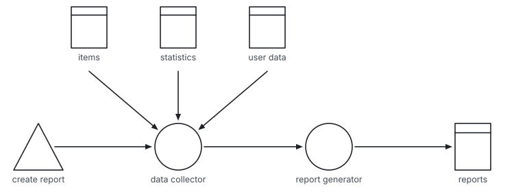

# Pipeline Diagrams

## Introduction

Diagrams are a good help when designing, describing or explaining how systems work. In order to help with the design and explanation of data pipelines (on AWS) we created Pipeline Diagrams: a small set of shapes that capture data pipelines, their components and inter-connections.

The notation is “whiteboard proof” meaning that it can easily be drawn on a whiteboard but it is also made suitable to use basic tools like keynote and powerpoint, or slightly more advanced modelling tools like omnigraffle and Visio.

The models gradually stiffen during a design. You can design your high level pipeline using only a couple of simple symbols and dive into more details of your architecture later by the basic shapes. We hope this helps you keep your focus at the right abstraction level. 

## What is a pipeline

A pipeline is any path that manipulates and stores data. It starts at a trigger or event, data gets processed and ends in a data store. Often you can spot pipelines by following the code path arrows that connect 2 datastores. A pipeline can consist of many other pipelines. In general we would say: if you can slap a name on a process between 2 datastores, it probably is, or should become a pipeline. 

<picture><source srcset="./images/example_pipeline-dark.svg" media="(prefers-color-scheme: dark)"></picture>

## Creating Pipeline Models

All shapes are available as a [draw.io](https://app.diagrams.net) library. The quickest way: [open draw.io with the library loaded](https://app.diagrams.net/?splash=0&clibs=Uhttps%3A%2F%2Fpipeline-diagrams.com%2Fdownloads%2Fpipeline-diagrams.drawio.xml).

Or add it to a diagram yourself:

1. Go to [draw.io](https://app.diagrams.net) and create a new diagram.
2. From the menu bar, select `File` > `Open Library from` > `URL`.
3. Enter `https://pipeline-diagrams.com/downloads/pipeline-diagrams.drawio.xml`.

The shapes appear in a new section of the shapes panel on the left. Libraries for Excalidraw and an icon pack for PowerPoint, Keynote and Miro are on the [Templates & tools](https://pipeline-diagrams.com/templates.html) page.

## Basic Shapes

There are a few basic shapes: circles, double-squares, triangles, arrows and rectangles. If you can draw these shapes you can model data pipelines on a whiteboard or cobble sketches together in a tool like powerpoint or keynote. 

| Shape | Image | Description |
| ----- | ----- | ----------- |
| Processor  | <picture><source srcset="./images/def_processor-dark.svg" media="(prefers-color-scheme: dark)"></picture>   | *Circle with an optional type indication inside. Name Required.* <br><br> A processor is a component that takes input data, processes it and writes its output. This normally means a processor transforms the input data into something new. A processor can be “always on”, or can be triggered by an event or manual action. A processor can take its input and send its output anywhere: a data store, a queue, a stream or another processor. Likewise for its output. |
| Data Store | <picture><source srcset="./images/def_data_store-dark.svg" media="(prefers-color-scheme: dark)"></picture> | *Square with a rectangular bar on top. The main square can contain a type indication. Name required.* <br><br> A data store is a persistent or temporary datastore of any type. The definition is quite liberal. S3 is seen as a key value store and uses the same symbol as a.o. DynamoDB and Postgresql. |
| Trigger    | <picture><source srcset="./images/def_trigger-dark.svg" media="(prefers-color-scheme: dark)"></picture>       | *Triangle with a possible type indication inside. Name Optional.* <br><br> A trigger is a process that kicks off a pipeline.                                                                                                                                                                            |
| Flow       | <picture><source srcset="./images/def_flow-dark.svg" media="(prefers-color-scheme: dark)"></picture>             | *Arrow with at least 1 arrow head that indicates the flow of data. Name optional.* <br><br> Flow is the connection between processors, storage and triggers. Flow comes in different types: synchronous, asynchronous, queued and streaming.                                                                       |
| Other      | <picture><source srcset="./images/def_other-dark.svg" media="(prefers-color-scheme: dark)"></picture>           | *Rectangle, no fill, identifier inside. Name optional.* <br><br> If it isn’t a processor, a data store or a trigger, it’s probably something else. Represented by a rectangle. There are some variations on the “other” icon, but if it fits, write the name of the system in the rectangle. |
| External   | <picture><source srcset="./images/def_external-dark.svg" media="(prefers-color-scheme: dark)"></picture>     | *Rectangle, solid fill. Name required.* <br><br> Sometimes you simply don’t care, do you? When your boundaries are strong it’s often enough to model an external system as a black box.                                                                                      |

## Diagrams

The diagrams in `images/` are generated SVGs, each in a light (`name.svg`) and a
dark (`name-dark.svg`) version. Pages show them with a `<picture>` element so they
follow the reader's light or dark mode; on the site use
``. To change a diagram, edit
`scripts/diagrams.mjs` and run:

```sh
node scripts/diagrams.mjs images
```

## Document Source

The source of this documentation can be found in [github](https://github.com/Sparkboxx/pipeline-modelling). This
documentation is automatically built into [pipeline-diagrams.com](https://pipeline-diagrams.com).


